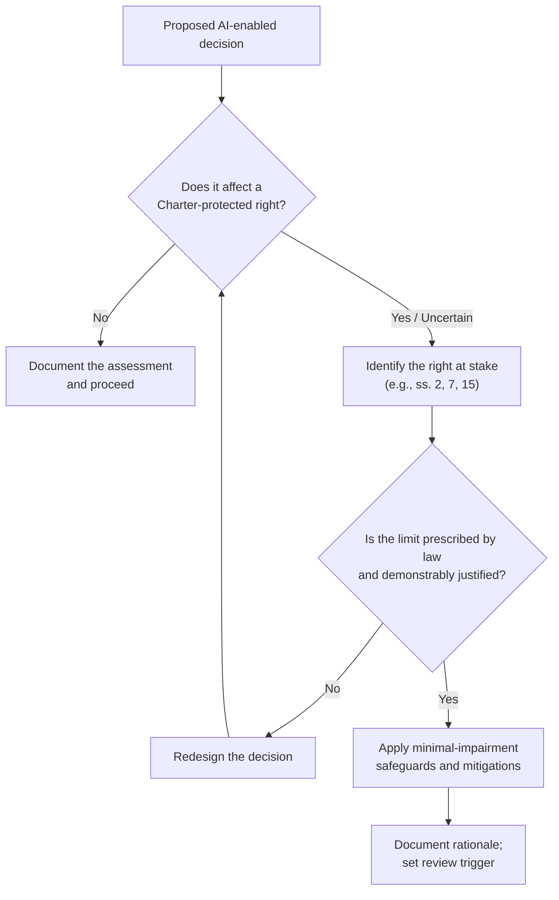

# CHARTER RIGHTS DECISION TREE™ — Rights-Aware Decision Design

## What it is

The Charter Rights Decision Tree is a structured screen that forces any AI-enabled or automated decision to confront the *Canadian Charter of Rights and Freedoms* before it is finalized. It translates constitutional reasoning into a repeatable executive practice: identify the rights at stake, test whether any limit is justified, apply the least intrusive design, and document the rationale. Rights are not a compliance checkbox at the end — they are a design input at the start.

*Treat "uncertain" as "yes" until the analysis says otherwise. The full test and worked cases are in the book.*

## When to use it

- Any automated or AI-assisted decision affecting individuals: benefits, enforcement, screening, prioritization.
- Procurement of AI systems that will touch rights-bearing decisions.
- Policy design where efficiency gains could come at the cost of equality or due process.
- As the rights screen inside step 2 of [DECIDE-PLUS™](DECIDE-PLUS.md).

## Three-step application

1. **Screen every decision, in writing.** Run the tree and record the answer — including "no rights affected" with reasons. An undocumented screen didn't happen.
2. **Design for minimal impairment.** If a right is affected, choose the least intrusive effective design: narrower data, human review points, appeal paths, sunset clauses. Mitigation is part of the architecture, not an apology after it.
3. **Make the rationale reviewable.** Document the legal basis, the justification analysis, the safeguards, and the review trigger. Oversight bodies and courts review records, not intentions.

## Go deeper

The complete decision tree — the full justification analysis, section-by-section guidance, and Canadian case studies — is in *Constitutional Intelligence* (FriesenPress, 2026, ISBN 978-1-03-835671-0). [fedethics.ca/book-hub](https://fedethics.ca/book-hub/)

*This is a companion overview, not legal advice.*
