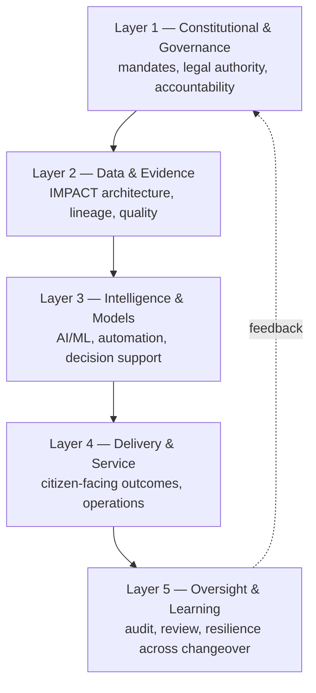

# FIVE-LAYER™ — Architecture for Trustworthy AI Systems

## What it is

FIVE-LAYER is a systems architecture for implementing AI that institutions can trust. Most AI failures are coordination failures: the model works, but governance, data, delivery, and oversight were never designed together. FIVE-LAYER treats trustworthy AI as a property of the whole stack — five layers that must be built and changed in concert, so no layer ships alone and no layer becomes a single point of institutional failure.

*Structural overview. The canonical layer definitions, controls, and interfaces are in the book.*

## When to use it

- Planning or reviewing any AI program that must survive scrutiny and electoral changeover.
- When pilots succeed but production stalls — usually a missing layer, not a bad model.
- When capacity building and legacy planning keep getting deferred to "phase two."
- To give executives, architects, and auditors one shared map of the program.

## Three-step application

1. **Locate your initiative across all five layers.** For each layer, write down what exists today and what is assumed. Gaps and assumptions are your risk register.
2. **Verify each layer's controls before scaling.** Governance authority signed, data qualified, model evaluated, delivery operable, oversight instrumented. A layer without controls is a layer you don't have.
3. **Coordinate change across layers.** Any change in one layer triggers review in the others — especially Layer 1 and Layer 5. Use [DECIDE-PLUS™](DECIDE-PLUS.md) for the decision record.

## Go deeper

The full FIVE-LAYER architecture — layer specifications, control catalogs, and coordination practices from real Canadian government cases — is in *Constitutional Intelligence* (FriesenPress, 2026, ISBN 978-1-03-835671-0). [fedethics.ca/book-hub](https://fedethics.ca/book-hub/)
